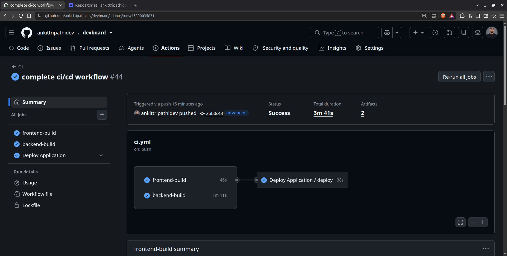
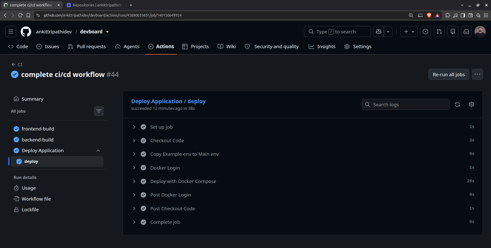

======================================================================

# 🧣 DAY-1: GitHub Actions – Introduction & First Workflow

======================================================================

## 1. Introduction to GitHub Actions
- GitHub Actions is a CI/CD automation platform that allows developers to automate software 
development workflows directly from GitHub.

**What can we automate?**

- Running tests and code quality checks.
- Building applications and Docker images.
- Deploying applications.
- Executing workflows on push or pull requests.

### What is CI/CD?

- **CI (Continuous Integration):** Automatically validates code whenever developers push changes.
- **CD (Continuous Delivery/Deployment):** Automates software release and deployment.

---

## 2. Create Your First Repository

**Step 1:** Go to [GitHub](https://github.com) and create a new repository.

**Step 2:** Create the following directory structure:

```text
github-actions-project/
│
└── .github/
    └── workflows/
        └── hello.yml
```

**Important:**

- `.github/workflows/` stores workflow files.
- Workflow files must use `.yml` or `.yaml` extensions.

---

## 3. GitHub Actions Architecture

```text
Workflow
   |
   |---- Trigger (on)
   |
   |---- Jobs
           |
           |---- Runner
           |
           |---- Steps
                   |
                   |---- Action (uses)
                   |
                   |---- Command (run)
```

### Important Components

| Component | Description                  |
| --------- | ---------------------------- |
| `name`    | Workflow name                |
| `on`      | Workflow trigger             |
| `jobs`    | Contains jobs                |
| Job ID    | Unique job identifier        |
| `runs-on` | Runner environment           |
| `steps`   | Individual tasks             |
| `run`     | Executes shell commands      |
| `uses`    | Uses existing GitHub Actions |

---

## 4. Create Your First Workflow – Hello World

Create `hello.yml` inside `.github/workflows/`.

```yaml
# Workflow Name
name: Hello

# Workflow Trigger
on:
  workflow_dispatch:

# Jobs
jobs:
  say-hello:
    # Runner
    runs-on: ubuntu-latest

    # Steps
    steps:
      - name: Say hello to everyone
        run: echo "Hello Dosto"
```

### Explanation

1. `name` – Defines the workflow name.
2. `on` – Defines when the workflow runs.
3. `workflow_dispatch` – Allows manual execution.
4. `jobs` – Contains one or more jobs.
5. Job ID (`say-hello`) – Unique identifier of a job.
6. `runs-on` – Defines the runner environment.
7. `steps` – Contains tasks executed sequentially.
8. `run` – Executes shell commands.
9. `uses` – Executes an existing GitHub Action.

**Example of `uses`:**

```yaml
- name: Checkout repository
  uses: actions/checkout@v7
```

This action checks out your repository code into the runner.

---

## 5. Workflow Trigger – Push Event

To execute the workflow automatically whenever code is pushed:

```yaml
name: Hello

on:
  push:

jobs:
  say-hello:
    runs-on: ubuntu-latest

    steps:
      - name: Say hello to everyone
        run: echo "Hello Dosto"
```

### Common Workflow Triggers

| Trigger             | Purpose                                                        |
| ------------------- | -------------------------------------------------------------- |
| `push`              | Runs when commits are pushed to a repository                   |
| `workflow_dispatch` | Allows manually executing a workflow                           |
| `workflow_call`     | Allows one workflow to be called or reused by another workflow |
| `pull_request`      | Runs on pull request events                                    |
| `schedule`          | Runs on a cron schedule                                        |

---

## 6. Execute Your Workflow

After pushing your YAML file to GitHub:

1. Open your repository.
2. Go to **Actions**.
3. Select the `Hello` workflow.
4. Click **Run workflow**.
5. Select the branch and confirm.

### Verify Execution

Open the workflow run → `say-hello` job → `Say hello to everyone` step.

**Expected Output:**

```text
Hello Dosto
```

---

## 7. Important Difference: `run` vs `uses`

| `run`                   | `uses`                |
| ----------------------- | --------------------- |
| Executes shell commands | Uses existing actions |
| `echo "Hello"`          | `actions/checkout@v7` |
| Runs commands on runner | Reuses an action      |

---

===================================================================================

# 🚀 DAY-2: GitHub Actions – Multiple Jobs, Reusable Workflows & CI/CD Pipeline

====================================================================================

## 1. Introduction
- GitHub Actions allows us to automate tasks using workflows.

We can create:

- **Single Job Workflow:** Executes tasks inside one job.
- **Multiple Job Workflow:** Executes multiple independent or dependent jobs.
- **Reusable Workflow:** Allows one workflow to call another workflow using `workflow_call`.
- **Automated Linter:** Automatically checks code quality whenever changes are pushed.

**Note:** The examples below use GitHub-hosted runners (`ubuntu-latest`). Self-hosted runners are a separate concept.

---

## 2. Example 1: Basic Workflow

**Goal:** Run a simple Hello message manually.

```yaml
# Workflow Name
name: Hello

# Trigger On
on:
  workflow_dispatch:

# Jobs
jobs:
  say-hello:
    runs-on: ubuntu-latest
    steps:
      - name: Hello Bolo
        run: echo "Hello Dosto"
```

**Key Points:**

- `workflow_dispatch`: Manually triggers the workflow.
- `runs-on`: Specifies the runner environment.
- `steps`: Contains tasks to execute.
- `run`: Executes shell commands.

---

## 3. Example 2: Multiple Jobs CI/CD Workflow

**Goal:** Create a basic CI/CD pipeline with four jobs.

```yaml
# Workflow Name
name: CICD

# Triggers on
on:
  workflow_dispatch:

# Jobs
jobs:
  # Job.1
  code-clone:
    runs-on: ubuntu-latest
    steps:
      - name: Clone the Code
        run: echo "Cloning the Code"

  # Job.2
  build:
    runs-on: ubuntu-latest
    steps:
      - name: Build Using Docker
        run: echo "Building Docker Image"

  # Job.3
  test:
    runs-on: ubuntu-latest
    steps:
      - name: Test Code Quality
        run: echo "Test the Code Quality"

  # Job.4
  deploy:
    runs-on: ubuntu-latest
    steps:
      - name: Deploy on Machine
        run: echo "Deploying code on Machine"
```

**Key Points:**

- Multiple jobs execute independently by default.
- Jobs can execute in parallel.
- `needs` is used to define job dependencies.
- This example only prints messages; it does not actually clone, build, test, or deploy code.

---

## 4. Example 3: Reusable Workflows Using `workflow_call`

**Goal:** Divide a CI/CD pipeline into separate reusable workflows.

### Step 1: Create Separate Workflows

**1. code-clone.yml**

```yaml
name: CODE

on:
  workflow_call:

jobs:
  code-clone:
    runs-on: ubuntu-latest
    steps:
      - name: Code Checkout/Code Clone
        uses: actions/checkout@v7

      - name: Print Message
        run: echo "Code Cloned Successfully"
```

**2. build.yml**

```yaml
name: BUILD

on:
  workflow_call:

jobs:
  build:
    runs-on: ubuntu-latest
    steps:
      - name: Build Image
        run: echo "Building Docker Image"
```

**3. test.yml**

```yaml
name: TEST

on:
  workflow_call:

jobs:
  test:
    runs-on: ubuntu-latest
    steps:
      - name: Test the Code Quality
        run: echo "Testing the Code Quality"
```

**4. deploy.yml**

```yaml
name: DEPLOY

on:
  workflow_call:

jobs:
  deploy:
    runs-on: ubuntu-latest
    steps:
      - name: Deploy on Machine
        run: echo "Deploying the Code"
```

### Step 2: Create Main CI/CD Workflow

**cicd.yml**

```yaml
name: CICD Pipeline

on:
  push:

jobs:
  code-clone:
    uses: ./.github/workflows/code-clone.yml

  build:
    needs: code-clone
    uses: ./.github/workflows/build.yml

  test:
    needs: build
    uses: ./.github/workflows/test.yml

  deploy:
    needs: [build, test]
    uses: ./.github/workflows/deploy.yml
```

### Key Points

- `workflow_call`: Makes a workflow reusable.
- `uses`: Calls another reusable workflow.
- `needs`: Defines dependencies between jobs.
- `needs: [build, test]`: Runs deploy only after both jobs succeed.
- Reusable workflows must be stored inside `.github/workflows/`.
- Reusable workflows are called at the job level, not inside steps.

### Execution Flow

```text
       CODE CLONE
            |
          BUILD
            |
           TEST
            |
          DEPLOY
```

**Important:** Each job gets its own runner environment. Files checked out in the `code-clone` job are not automatically available in the `build`, `test`, or `deploy` jobs. Use checkout again or pass files using artifacts when required.

---

## 5. Example 4: Automate Python Code Quality Using Ruff

**Goal:** Whenever Python files are pushed, GitHub Actions automatically runs Ruff to check code quality and formatting.

### Step 1: Create Python Application

**app.py**

```python
# This code is from https://github.com/ankittripathidev/flask-app-ec2.git

from flask import Flask, render_template

app = Flask(__name__)

@app.route('/')
def hello_world():
    return render_template('index.html')

@app.route('/health')
def health():
    return 'Server is up and running'
```

### Step 2: Create GitHub Actions Workflow

**.github/workflows/linter.yml**

```yaml
name: Auto Linter

on:
  push:
    paths:
      - "**/*.py"

jobs:
  code:
    runs-on: ubuntu-latest

    steps:
      # Checkout Code
      - uses: actions/checkout@v7

      # Setup Python
      - uses: actions/setup-python@v7
        with:
          python-version: "3.13"

      # Install Ruff & Run Checks
      - name: Run Ruff Checks
        run: |
          pip install ruff
          ruff check .
          ruff format --check .
```

### What is Ruff?

Ruff is a fast Python linter and code formatter.

**Ruff checks:**

- Python code quality.
- Syntax and common coding errors.
- Import sorting.
- Code formatting (when configured).

### Important Commands

| Command                 | Purpose                                      |
| ----------------------- | -------------------------------------------- |
| `pip install ruff`      | Installs Ruff                                |
| `ruff check .`          | Checks linting errors                        |
| `ruff check . --fix`    | Automatically fixes supported linting errors |
| `ruff format .`         | Automatically formats Python files           |
| `ruff format --check .` | Checks formatting without modifying files    |

**Important:**

- `ruff check .` detects linting errors.
- `ruff check . --fix` fixes supported linting errors.
- `ruff format .` formats Python files.
- `ruff format --check .` verifies formatting without modifying files.
- If either CI check fails, the GitHub Actions job fails.

**Best Practice:** In CI/CD pipelines, use check-only commands. Fix errors locally, commit the changes, and let GitHub Actions verify them.

---

## 6. Important GitHub Actions Concepts

| Concept                | Purpose                                         |
| ---------------------- | ----------------------------------------------- |
| `workflow_dispatch`    | Manually runs a workflow                        |
| `workflow_call`        | Makes a workflow reusable                       |
| `push`                 | Runs when commits are pushed                    |
| `pull_request`         | Runs on pull request events                     |
| `schedule`             | Runs on a cron schedule                         |
| `runs-on`              | Specifies the runner environment                |
| `uses`                 | Uses an action or reusable workflow             |
| `run`                  | Executes shell commands                         |
| `needs`                | Defines job dependencies                        |
| `paths`                | Filters workflow triggers by changed file paths |
| `actions/checkout`     | Checks out repository code                      |
| `actions/setup-python` | Sets up Python                                  |

---


# 🚀 DAY-3: GitHub Actions – Self-Hosted Runners & CI/CD Deployment

---

## Types of GitHub Runners

A runner is a machine that executes GitHub Actions workflow jobs.

| Runner        | Description                    |
| ------------- | ------------------------------ |
| GitHub-hosted | Managed by GitHub.             |
| Self-hosted   | Managed and maintained by you. |

**GitHub-hosted Runner:**

```yaml
runs-on: ubuntu-latest
```

- Managed by GitHub.
- A fresh environment is generally provided for each job.
- Suitable for CI tasks like testing and building.

**Self-hosted Runner:**

```yaml
runs-on: self-hosted
```

- Managed by you.
- Can run on AWS EC2 or a local machine.
- Useful for deployment on your own infrastructure.

---


## Step 1 – Create an EC2 Instance on AWS
- Go to **AWS Console → EC2 → Launch Instance**.


## Step 2 – Create a Self-Hosted Runner on GitHub

Navigate to:

**GitHub Repository → Settings → Actions → Runners → New self-hosted runner**

Select:

- Runner image: **Linux**
- Architecture: **x64** (if your EC2 instance uses x86-64)

**Important:** GitHub will display commands to download and configure the runner.

---

## Step 3 – Download and Configure the Runner on EC2

### Download

The following is an example. Use the download URL and version shown on your repository's runner setup page.

```bash
# Create a directory for the GitHub Actions runner
mkdir actions-runner && cd actions-runner

# Download the runner package
# Use the current URL provided by GitHub.

# Extract the downloaded package
tar xzf ./actions-runner-linux-x64-<VERSION>.tar.gz
```

### Configure

Copy the configuration command shown by GitHub. It follows this general format:

```bash
./config.sh --url https://github.com/OWNER/REPOSITORY --token <REGISTRATION_TOKEN>
```

During configuration, GitHub asks for a few details.

| Prompt            | Example                                                                       |
| ----------------- | ----------------------------------------------------------------------------- |
| Runner group      | Press Enter to use Default                                                    |
| Runner name       | `devboard-runner`                                                             |
| Additional labels | Press Enter to skip, or add labels                                            |
| Work folder       | Press Enter to use `_work`, or enter a custom folder. Example: `devboard_work` |

After successful configuration, GitHub displays a message similar to:

```text
√ Runner successfully added
√ Settings Saved
```

---

## Step 4 – Start the Self-Hosted Runner

For a quick test, you can start the runner in the foreground:

```bash
./run.sh
```

Keep the terminal session open while testing. Closing the session stops the runner process.

### Recommended: Run the Runner as a Service

For an EC2 instance that should keep accepting jobs after you disconnect from SSH, configure the runner as a service:

```bash
# From the actions-runner directory
sudo ./svc.sh install
sudo ./svc.sh start
```

Check its status:

```bash
sudo ./svc.sh status
```

You can also stop and restart it:

```bash
sudo ./svc.sh stop
sudo ./svc.sh start
```

### Verify Runner Status on GitHub

Go to:

**Repository → Settings → Actions → Runners**

The runner should appear as **Idle** when it is online and waiting for a job.

---

## Step 5 – Configure CI Workflow on GitHub-Hosted Runners

Create the following file:

```text
.github/
└── workflows/
    └── ci.yml
```

The CI workflow runs on GitHub-hosted runners using `ubuntu-latest`.

### CI Workflow – `ci.yml`

**Goal:** Lint, test, and build the frontend and backend, then push Docker images to DockerHub.

```yaml
# Goal: Lint, Test, Build Frontend & Backend
# Then Push Docker Images to DockerHub

# Workflow Name
name: CI

# Triggers On
on:
  push:
    branches:
      - advanced

# Minimum permissions
permissions:
  contents: read

jobs:
  # ==========================================
  # JOB 1: FRONTEND BUILD
  # ==========================================
  frontend-build:
    runs-on: ubuntu-latest

    steps:
      - name: Checkout Code
        uses: actions/checkout@v7

      # Setup Node.js
      - name: Setup Node.js
        uses: actions/setup-node@v7
        with:
          node-version: 24
          cache: npm
          cache-dependency-path: ./frontend/package-lock.json

      # Install Dependencies
      - name: Install npm Packages
        run: npm ci
        working-directory: ./frontend

      # Lint
      - name: Run Linter
        run: npm run lint
        working-directory: ./frontend

      # Test
      - name: Run Tests
        run: npm run test
        working-directory: ./frontend

      # Docker Login
      - name: Docker Login
        uses: docker/login-action@v4
        with:
          username: ${{ vars.DOCKERHUB_USERNAME }}
          password: ${{ secrets.DOCKERHUB_TOKEN }}

      # Docker Build & Push
      - name: Docker Build and Push
        uses: docker/build-push-action@v7
        with:
          context: ./frontend
          push: true
          tags: ${{ vars.DOCKERHUB_USERNAME }}/devboard-frontend:latest


  # ==========================================
  # JOB 2: BACKEND BUILD
  # ==========================================
  backend-build:
    runs-on: ubuntu-latest

    steps:
      - name: Checkout Code
        uses: actions/checkout@v7

      # Setup Go
      - name: Setup Go
        uses: actions/setup-go@v7
        with:
          go-version-file: ./backend/go.mod
          cache-dependency-path: ./backend/go.sum

      # Check Go formatting without modifying files
      - name: Check Go Formatting
        working-directory: ./backend
        run: |
          files=$(gofmt -l .)

          if [ -n "$files" ]; then
            echo "The following files need formatting:"
            echo "$files"
            exit 1
          fi

          echo "All Go files are properly formatted!"

      # Lint
      - name: Go-lang Linter
        uses: golangci/golangci-lint-action@v9
        with:
          version: v2.13
          working-directory: ./backend

      # Go Vet
      - name: Run Go Vet
        run: go vet ./...
        working-directory: ./backend

      # Test
      - name: Run Tests
        run: go test -v -race ./...
        working-directory: ./backend

      # Docker Login
      - name: Docker Login
        uses: docker/login-action@v4
        with:
          username: ${{ vars.DOCKERHUB_USERNAME }}
          password: ${{ secrets.DOCKERHUB_TOKEN }}

      # Docker Build & Push
      - name: Docker Build and Push
        uses: docker/build-push-action@v7
        with:
          context: ./backend
          push: true
          tags: ${{ vars.DOCKERHUB_USERNAME }}/devboard-backend:latest


  # ==========================================
  # JOB 3: DEPLOY
  # ==========================================
  deploy:
    name: Deploy Application
    needs:
      - build-frontend
      - build-backend
    uses: ./.github/workflows/cd.yml
    secrets: inherit
```

### Explanation

| Configuration      | Purpose                                          |
| ------------------ | ------------------------------------------------ |
| `deploy`           | Unique job ID for deployment.                    |
| `needs`            | Waits for the frontend and backend jobs.         |
| `uses`             | Calls the reusable CD workflow.                  |
| `secrets: inherit` | Passes available secrets to the called workflow. |

**Important:** `needs` must use the exact job IDs defined under `jobs`, not the job display names.

Because the Docker build and push steps are part of the frontend and backend jobs, deployment waits for those jobs to finish successfully.

---

### DockerHub Secrets and Variables

Go to:

**Repository → Settings → Secrets and variables → Actions**

Create:

**Repository variable**

```text
DOCKERHUB_USERNAME = ankittripathidev
```

**Repository secret**

```text
DOCKERHUB_TOKEN = <YOUR_DOCKERHUB_ACCESS_TOKEN>
```

Use a DockerHub access token instead of your DockerHub account password.

- Click on your profile.
- Open Account Settings.
- Select Personal Access Tokens.
- Generate a new token.

---

## Step 6 – Install Docker and Docker Compose on EC2

```bash
# Update Ubuntu packages
sudo apt update
sudo apt upgrade -y

# Install Docker and Compose
sudo apt install -y docker.io docker-compose-v2

# Check versions
docker --version
docker compose version

# Give user Docker permissions
sudo usermod -aG docker $USER
newgrp docker

# Verify
docker ps
```

---

## Step 7 – Create a Reusable CD Workflow

Create another file:

```text
.github/
└── workflows/
    ├── ci.yml
    └── cd.yml
```

The CD workflow uses `workflow_call`, which allows the CI workflow to call it as a reusable workflow.

### CD Workflow – `cd.yml`

**Goal:** Deploy Docker images after the CI workflow has completed successfully.

```yaml
# Goal: Deploy Docker Images on Self-Hosted Runner

# Workflow Name
name: CD

# Triggers On
on:
  workflow_call:

# Minimum permissions
permissions:
  contents: read

# Jobs
jobs:
  deploy:
    runs-on: self-hosted

    steps:
      - name: Checkout Code
        uses: actions/checkout@v7

      - name: Copy Example env to Main env
        run: cp .env.example .env

      # Docker Login
      - name: Docker Login
        uses: docker/login-action@v4
        with:
          username: ${{ vars.DOCKERHUB_USERNAME }}
          password: ${{ secrets.DOCKERHUB_TOKEN }}

      # Deploy Containers
      - name: Deploy with Docker Compose
        run: |
          docker compose pull
          docker compose up -d
```

### Explanation

| Configuration          | Purpose                                         |
| ---------------------- | ----------------------------------------------- |
| `workflow_call`        | Makes the CD workflow reusable.                 |
| `runs-on: self-hosted` | Runs deployment on your EC2 self-hosted runner. |
| `docker compose pull`  | Pulls images referenced by Docker Compose.      |
| `docker compose up -d` | Creates or updates containers in detached mode. |

**Production note:** Copying `.env.example` over `.env` is suitable only for a simple demonstration when the example file contains usable non-secret configuration. For production, keep a separately managed production `.env` file containing real configuration and secrets. Do not overwrite it during every deployment.

---

## Step 8 – Check the Self-Hosted Runner

If you started the runner manually and it is not running, connect to EC2:

```bash
cd ~/actions-runner
./run.sh
```

If you configured it as a service, check it instead:

```bash
cd ~/actions-runner
sudo ./svc.sh status
```

Go to:

**GitHub Repository → Settings → Actions → Runners**

Verify that the runner is **Idle** and online.

---

## Step 9 – Configure EC2 Security Group Inbound Rules

Open:

**AWS Console → EC2 → Security Groups → Select Security Group → Edit Inbound Rules**

Allow only the ports required by your application.

Example:

| Port | Purpose                                | Recommended access                       |
| ---- | -------------------------------------- | ---------------------------------------- |
| 22   | SSH                                    | Your trusted IP address only             |
| 80   | HTTP                                   | Public, if serving HTTP                  |
| 443  | HTTPS                                  | Public, if serving HTTPS                 |
| 8080 | Application port, if directly exposed  | Restrict or place behind a reverse proxy |

**Important security points:**

- Do not expose PostgreSQL port `5432` publicly.
- Do not expose backend ports publicly unless your architecture requires it.
- If the frontend is served through port `80` or `443`, open those ports instead of assuming it uses `8080`.
- Check the actual host port mappings in `docker-compose.yml`.
- Prefer HTTPS for public production applications.

---

## Step 10 – Open the Application in a Browser

Find the EC2 instance's public IP address.

If your frontend is mapped to port `8080`, open:

```text
http://<EC2-PUBLIC-IP>:8080
```

The correct URL depends on the port mapping in your Docker Compose configuration and your EC2 security group.

---

## Step 11 – Verify the CI/CD Workflow

After pushing code to the `advanced` branch:

```bash
git add .
git commit -m "Add GitHub Actions CI/CD workflow"
git push origin advanced
```

Go to:

**GitHub Repository → Actions**

Verify:

1. Frontend job succeeds.
2. Backend job succeeds.
3. Deploy job succeeds.
4. The self-hosted runner executes the deployment.
5. Docker Compose pulls the required images.
6. Containers are running on EC2.
7. The application opens in the browser.

### Successful GitHub Actions Deployment




The attached screenshot shows a successful workflow run:

- `build-frontend` – Successful
- `build-backend` – Successful
- `deploy` – Successful

---

**Final takeaway:** CI validates and publishes the application images. CD deploys those images on the self-hosted EC2 runner.